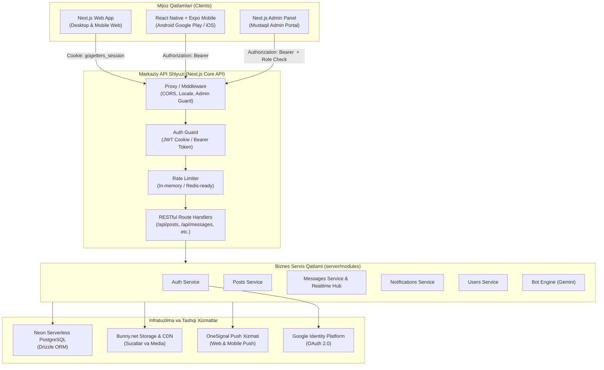

# THE GO-GETTERS (FIKR) — MULTI-PLATFORM SYSTEM ARCHITECTURE

> **Hujjat turi:** Tizim Arxitekturasi va Loyiha Chegaralari (Architecture & System Design)  
> **Loyiha:** The Go-getters Platform (Web, Mobile, Admin & API)  
> **Versiya:** 1.0.0  
> **Holat:** Tasdiqlangan Texnik Arxitektura  
> **Muallif:** CTO & Principal Software Architect  

---

## 1. STRATEGIK ARXITEKTURA VA MONOREPO TUZILISHI

Loyihaning uzoq muddatli barqarorligi va yuqori muhandislik sifatini ta'minlash uchun repository monorepo arxitekturasiga ajratiladi. Mavjud Web va Backend bazasi buzilmagan holda saqlanadi, shu bilan birga mustaqil `mobile/` va `admin/` ilovalari uchun poydevor qo'yiladi.

```
my-first-startup/ (Monorepo Root)
├── app/                  # [Web Frontend & Core API] Mavjud Next.js 16 App Router
│   ├── [locale]/         # Web sahifalari (Feed, Profile, Messages, Bookmarks, Search, Settings)
│   └── api/              # Markaziy RESTful HTTP API (Mobile, Web va Admin foydalanadi)
├── components/           # Web UI komponentlari va AppShell
├── lib/                  # Web utilitalari, i18n lug'atlari, client API adapterlari
├── server/               # [Shared Server Layer] Biznes logika, ORM, servislar va xavfsizlik
│   ├── db/               # Neon PostgreSQL schema, migratsiyalar, seed
│   ├── modules/          # Domain Services (Auth, Posts, Comments, Messages, Notifications, Users)
│   ├── bot-engine/       # Gemini AI asosidagi avtonom bot generatorlari
│   └── common/           # Auth guard, admin guard, crypto, rate limiter, storage
├── mobile/               # [Mustaqil Mobil Ilova] React Native + Expo SDK
│   ├── app/              # Expo Router navigatsiyasi (tabs, stacks, modals)
│   ├── src/
│   │   ├── features/     # Modullar (auth, feed, posts, messages, notifications, profile)
│   │   ├── components/   # Native UI kit (Button, Input, Card, Skeleton, Avatar, Dialog)
│   │   ├── services/     # API Client, SecureStore, Push Notification service
│   │   ├── hooks/        # React Query hooks, auth hooks, network hooks
│   │   ├── theme/        # Web Tailwind bilan sinxron ranglar, shriftlar, radiuslar
│   │   └── types/        # TypeScript modellari
│   ├── app.json          # Expo konfiguratsiyasi, Android package name, ruxsatlar
│   └── package.json      # Mustaqil mobil bog'liqliklar
├── admin/                # [Mustaqil Admin Panel] Mustaqil Next.js Dashboard
│   ├── app/              # Admin Router (Overview, Users, Posts, Moderation, Engine, Audit)
│   ├── components/       # Admin UI jadvallari, filtrlari, statistik grafiklari
│   ├── lib/              # Admin API client va RBAC tekshiruvlari
│   └── package.json      # Mustaqil admin bog'liqliklar
├── pnpm-workspace.yaml   # Monorepo paketlar boshqaruvi
├── package.json          # Root orchestration scriptlari
├── WEB_FEATURE_INVENTORY.md
├── API_CONTRACTS.md
├── ARCHITECTURE.md
└── IMPLEMENTATION_PLAN.md
```

---

## 2. MA'LUMOTLAR OQIMI VA TIZIM INTEGRATSIYASI



---

## 3. AUTENTIFIKATSIYA VA SESSIYALAR MODELI

Tizimda gibrid, ko'p platformali xavfsiz autentifikatsiya mexanizmi joriy qilingan:

1. **Web Ilova Uchun:**
   - Standart brauzer muhiti uchun `HttpOnly; Secure; SameSite=Lax` cookie `gogetters_session` ishlatiladi.
   - Bu XSS hujumlarida token o'g'irlanishining oldini oladi.

2. **Mobile Ilova Uchun:**
   - React Native brauzer cookie'larini veb-sahifalar kabi avtomatik boshqara olmaydi.
   - Mobil ilova login yoki Google Sign-In orqali olingan JWT sessiya tokenini `expo-secure-store` (Android Keystore / iOS Keychain) xotirasida shifrlangan holda saqlaydi.
   - Har bir HTTP so'rovida `Authorization: Bearer <token>` sarlavhasi yuboriladi.
   - Backend `server/common/auth-guard.ts` ichidagi `getTokenFromRequest` avval `Bearer` sarlavhasini, so'ngra cookie'ni tekshiradi. Ikkala klient ham yagona kod orqali to'liq autentifikatsiyadan o'tadi!

3. **Admin Panel Uchun:**
   - Maxsus administrator roli tekshiruvi (`ADMIN`, `SUPER_ADMIN` yoki `ADMIN_EMAILS`).
   - Server-side RBAC: har bir ma'lumot o'chirish, bloklash yoki statistika so'rovida `enforceAdminGuard` server darajasida ruxsatni tekshiradi.

---

## 4. REAL-TIME VA BILDIRISHNOMALAR (PUSH) ARXITEKTURASI

### 4.1. Direct Messages Real-Time (SSE & Hub)
- **Web:** Brauzerdagi `EventSource` obyekti orqali `/api/messages/stream` ulanishi amalga oshiriladi.
- **Mobile:** React Native muhitida SSE `react-native-sse` yoki streaming `fetch` orqali `server/modules/messages/realtime-hub.ts` bilan ulanadi.
- **Kafolat:** Har bir yuborilgan xabarda `clientMessageId` mavjud bo'lib, idempotent yozish kafolatlanadi. Tarmoq uzilib-ulanganda `/api/messages/sync` orqali yetkazilmagan xabarlar tiklanadi.

### 4.2. Push Notifications (OneSignal & Expo Push)
- Android 13+ qurilmalarida `POST_NOTIFICATIONS` ruxsati so'raladi.
- Qurilma push tokeni olinadi va backenddagi `notification_settings` yoki qurilmalar reestriga biriktiriladi.
- Foydalanuvchiga yangi xabar, izoh, like yoki obuna kelganda, backend `notifications.service.ts` orqali OneSignal REST API'ga chaqiruv yuboradi.
- Bildirishnoma bosilganda universal link / deep link (`gogetters://posts/:id` yoki `gogetters://messages/:id`) orqali to'g'ri ekranga o'tiladi.

---

## 5. FOYDALANUVCHI INTERFEYSI VA DIZAYN TIZIMI PARITETI

Web va Mobil ilovalar o'rtasidagi vizual yaxlitlikni saqlash uchun dizayn tokenlari qat'iy standartlashtiriladi:

| Element | Dizayn Tokeni (Web Tailwind) | Mobile (React Native Theme) | Qiymat |
|---|---|---|---|
| **Primary Color** | `blue-600` / `blue-500` | `theme.colors.primary` | `#2563eb` / `#3b82f6` |
| **Background (Light)** | `slate-50` / `white` | `theme.colors.background` | `#f8fafc` / `#ffffff` |
| **Background (Dark)** | `slate-950` / `slate-900` | `theme.colors.backgroundDark` | `#020617` / `#0f172a` |
| **Text Primary** | `slate-950` / `white` | `theme.colors.textPrimary` | `#020617` / `#ffffff` |
| **Text Muted** | `slate-500` / `slate-400` | `theme.colors.textMuted` | `#64748b` / `#94a3b8` |
| **Border Color** | `slate-200` / `slate-800` | `theme.colors.border` | `#e2e8f0` / `#1e293b` |
| **Success / Verified** | `emerald-500` | `theme.colors.success` | `#10b981` |
| **Danger / Delete** | `rose-500` / `red-600` | `theme.colors.danger` | `#f43f5e` / `#dc2626` |
| **Border Radius** | `rounded-xl` / `rounded-2xl` | `theme.radii.lg` / `xl` | `12px` / `16px` |
| **Font Family** | Geist / Inter / Sans-serif | System Sans (Roboto / Inter) | 400 (Regular), 500 (Medium), 600 (Semibold), 700 (Bold) |

---

## 6. HOLAT BOSHQARUVI VA OFFLINE STRATEGIYA

1. **Server State:**
   - Mobil ilovada **TanStack Query (React Query v5)** ishlatiladi.
   - Kesh siyosati: `staleTime: 5 * 60 * 1000` (5 daqiqa), `gcTime: 24 * 60 * 60 * 1000`.
   - Infinite pagination: `useInfiniteQuery` orqali kursor asosida lentani uzluksiz yuklash.
   - Optimistic updates: Like va saqlash tugmalari bosilganda server javobini kutmasdan UI darhol yangilanadi, xatolik bo'lsa avvalgi holatga qaytariladi (rollback).

2. **Client / App State:**
   - Autentifikatsiya va joriy foydalanuvchi ma'lumotlari: `AuthContext` + `expo-secure-store`.
   - Til (i18n): `I18nContext` (`uz`, `ru`, `en`) + `@react-native-async-storage/async-storage`.
   - Mavzu (Theme): `ThemeContext` (Light / Dark / System).

3. **Skeleton Loading Standarti:**
   - Barcha yuklanish holatlari uchun mos o'lchamdagi Shimmer Skeleton komponentlari ishlatiladi.
   - Kontent yuklanayotganda ekranning sakrashi (Layout Shift) nolga tenglashtiriladi.

---

## 7. XAVFSIZLIK VA AUDIT STANDARTLARI (OWASP ASVS)

- **Token Xavfsizligi:** JWT muddati 30 kun, har bir sessiya `user_sessions` jadvalida ro'yxatga olingan. Foydalanuvchi seansni bekor qilganda, token zudlik bilan yaroqsiz bo'ladi.
- **SQL Injection Himoyasi:** Drizzle ORM ning parametrli so'rovlaridan foydalaniladi, xom string concatenation qat'iy man etilgan.
- **XSS & Content Sanitization:** Barcha post va izoh matnlari `sanitize-html` oq sanitizatsiya qoidalaridan o'tkaziladi.
- **IDOR / BOLA Himoyasi:** Post, izoh yoki suhbatni o'zgartirish/o'chirishdan oldin server joriy foydalanuvchi ushbu resursning haqiqiy muallifi ekanligini bazadan tekshiradi.
- **Audit Logging:** Admin paneldan bajarilgan har bir muhim operatsiya (postni o'chirish, foydalanuvchini bloklash, botlarni ishga tushirish) server tomonidan `bot_activities` va audit jadvallariga yoziladi.
