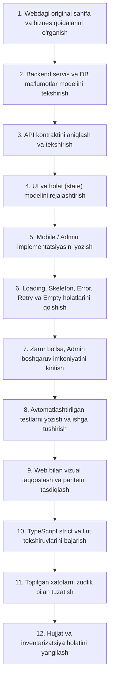

# THE GO-GETTERS (FIKR) — MASTER IMPLEMENTATION PLAN & ROADMAP

> **Hujjat turi:** Bosqichma-bosqich Amalga Oshirish Rejasi (Implementation Plan & Execution Matrix)  
> **Loyiha:** The Go-getters Platform (Web, Mobile, Admin & API)  
> **Versiya:** 1.0.0  
> **Mas'ul:** CTO & Principal Engineering Leads  

---

## 1. STRATEGIK BOSQICHLAR (PHASES 0 TO 8)

| Bosqich | Nomi | Asosiy Vazifalar | Sifat Darvozasi (Quality Gate Mezonlari) | Holat |
|---|---|---|---|---|
| **Phase 0** | **Audit & Rejalashtirish** | Repository, DB, API va Web funksiyalarini to'liq tekshirish, audit hujjatlarini yaratish | `WEB_FEATURE_INVENTORY.md`, `API_CONTRACTS.md`, `ARCHITECTURE.md`, `IMPLEMENTATION_PLAN.md` mavjudligi | **TUGALLANDI (DONE)** |
| **Phase 1** | **Arxitektura & Foundation** | Monorepo strukturasini sozlash (`pnpm-workspace.yaml`), `mobile/` (React Native + Expo SDK) va `admin/` (Next.js) poydevorini xavfsiz yaratish | TypeScript strict, Lint va build skriptlari har bir modulda xatosiz ishlashi | **NAVBATDAGI (IN PROGRESS)** |
| **Phase 2** | **Vertical Slice #1: Auth & Sessiyalar** | Mobil va Admin uchun markaziy API integratsiyasi: Login, Register, Google Auth, Onboarding, Session Restore, Logout | Haqiqiy Neon DB bilan integratsiya, token saqlash, avtorizatsiyadan o'tish testlari | **REJALASHTIRILGAN** |
| **Phase 3** | **Mobile Design System & Core Shell** | Ranglar, tipografiya, Tugmalar, Inputlar, Kartalar, Shimmer Skeletonlar, Navigation Tabs va Stacklar | Web bilan 100% vizual izchillik, Reduced-motion qo'llab-quvvatlash | **REJALASHTIRILGAN** |
| **Phase 4** | **Asosiy Mobil Funksiyalari** | Lenta (Feed), Post yaratish, Post tafsilotlari, Nested izohlar, Saqlanganlar, Qidiruv, Foydalanuvchi profili | Infinite scroll, optimistik likelar, rasm yuklash, empty/error/retry holatlari | **REJALASHTIRILGAN** |
| **Phase 5** | **Media, Chat & Push Bildirishnomalar** | Bunny.net CDN yuklash, Real-time Direct Messages (SSE), OneSignal Native Push integratsiyasi, Deep Linking | Idempotent xabarlar, Android background & foreground push xabarnomalari | **REJALASHTIRILGAN** |
| **Phase 6** | **Mustaqil Next.js Admin Panel** | Alohida `admin/` ilovasida RBAC, Tizim statistikasi, Foydalanuvchilar moderatsiyasi, Postlar nazorati, Bot Engine, Audit Log | Faqat admin rollari kirishi, audit yozuvlari, server-side validatsiya | **REJALASHTIRILGAN** |
| **Phase 7** | **QA, Hardening & Security Audit** | Unit, Integration, E2E testlar, OWASP xavfsizlik tekshiruvlari, IDOR tekshiruvlari, xotira sarfi (profiling) | Barcha testlarning yashil (PASS) o'tishi, nol critical/high xatolik | **REJALASHTIRILGAN** |
| **Phase 8** | **Google Play Production Readiness** | Android App Bundle (AAB), Play Console deklaratsiyalari, Data Safety, Release imzolash (Keystore), Smoke tests | Play Store talablariga to'liq mos AAB va release checklist | **REJALASHTIRILGAN** |

---

## 2. BIRINCHI VERTICAL SLICE TANLOVI: AUTH & PROFILE INTEGRATSIYASI

Barcha qismlarni bir vaqtda boshlash o'rniga, eng muhim poydevor hisoblangan **Vertical Slice #1: Autentifikatsiya, Sessiya va Onboarding** moduli tanlanadi.

### Nega aynan Auth?
1. Mobil ilova va Admin paneldagi boshqa barcha modullar (Feed, Like, Bookmark, Messages, Notifications, Create Post) joriy autentifikatsiya qilingan foydalanuvchiga (`authUser`) tayanadi.
2. Bu modul orqali to'liq stack ishlashi amalda isbotlanadi:
   - **UI:** Mobile Login screen, Inputlar, Xatolik xabarlari, Loading holatlari
   - **API:** `POST /api/auth/google/verify` va `GET /api/auth/session`
   - **Security:** `expo-secure-store` yordamida JWT token saqlash va `Authorization: Bearer` yuborish
   - **Backend:** `requireAuth` va `getOptionalAuth` orqali tokenni tekshirish
   - **Database:** Neon PostgreSQL `users` va `user_sessions` jadvallarida sessiyani ro'yxatga olish
   - **Error Handling:** 401 Unauthorized, eskirgan sessiyadan toza chiqish, qayta kirish
   - **Verification & Tests:** Haqiqiy integratsiya testi orqali tekshirish

---

## 3. HAR BIR MODUL UCHUN MAJBURIY SIKL VA DEFINITION OF DONE

Har bir modul quyidagi 12 qadamli tsikl asosida bajariladi:

### Definition of Done (DoD) Mezonlari:
- [ ] Web referens o'rganilgan va vizual moslik ta'minlangan.
- [ ] Real backend API bilan to'liq integratsiya qilingan (mock ma'lumotlar yo'q).
- [ ] TypeScript strict rejimida tip xatoliklari mavjud emas.
- [ ] Server va klientda xavfsizlik (auth/authorization) to'liq ishlaydi.
- [ ] Shimmer skeleton, bo'sh (empty), xato (error) va qayta urinish (retry) holatlari mavjud.
- [ ] Android back tugmasi va keyboard holatlari to'g'ri boshqarilgan.
- [ ] Integratsiya va unit testlar muvaffaqiyatli o'tgan (`PASS`).
- [ ] Mavjud veb-funksiyalarida hech qanday regressiya yuz bermagan.

---

## 4. XATARLAR VA ULARNI BARTARAF ETISH (RISK MANAGEMENT)

1. **Xatar: Next.js 16 App Router va Expo Monorepo mosligi**
   - *Tahlil:* Monorepo ichida React 19 va turli kutubxonalar paketlar ziddiyatini (dependency collision) keltirib chiqarishi mumkin.
   - *Yechim:* `mobile/` va `admin/` mustaqil `package.json` fayllari bilan ajratiladi. Umumiy tiplar va kontraktlar orqali bog'lanadi, ko'r-ko'rona umumiy node_modules aralashuviga yo'l qo'yilmaydi.

2. **Xatar: Google Play Console talablari (Target SDK & Privacy)**
   - *Tahlil:* Google Play Store Android 14+ (API Level 34/35) va Data Safety deklaratsiyasini qat'iy talab qiladi.
   - *Yechim:* Expo SDK ning amaldagi barqaror versiyasi tanlanadi, keraksiz permissions (kamera, geolokatsiya) AndroidManifest'dan olib tashlanadi, faqat zarur media va bildirishnoma ruxsatlari qoldiriladi.

3. **Xatar: Real-time xabarlar va Push yetkazilishi**
   - *Tahlil:* Mobil qurilma fonda (background) yoki uxlab yotganda (Doze mode) SSE aloqasi uziladi.
   - *Yechim:* Ilova ochiqligida SSE, ilova yopilganda esa OneSignal Push orqali yetkazish mexanizmi qo'llanadi.
